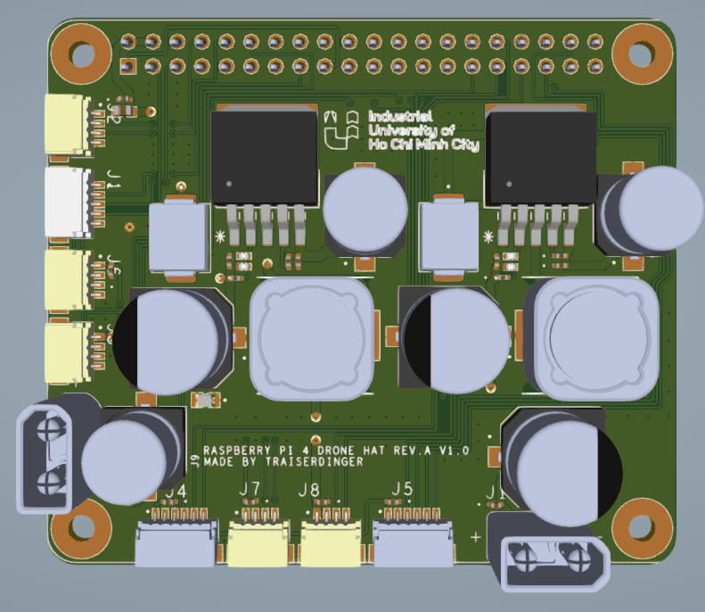
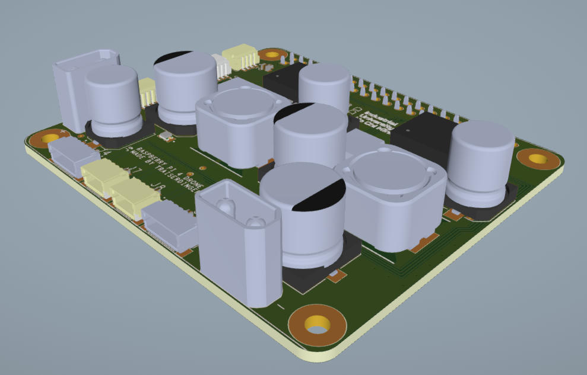

# Raspberry-Pi-4-UAV-Vision

Autonomous UAV delivery system using **PX4**, a **Raspberry Pi 4** companion computer, **ArUco** computer vision and a **YDLiDAR X2**, built for the **UAV Drone Soccer 2026 (Group C)**.

This repository holds the hardware and software of the companion-computer side of the drone. The first part published is the **Raspberry Pi 4 Drone HAT**: a custom HAT that powers the Pi from the flight battery and connects it to the flight controller, LiDAR, servo driver and expansion sensors.

| Part | Revision | EDA tool | Status |
|---|---|---|---|
| [Raspberry Pi 4 Drone HAT](hardware/rpi4-drone-hat/rev-a-v1.0) | **Rev A** (V1.0) | OrCAD Capture CIS 24.1 + Allegro PCB Editor 24.1 | Layout complete, under design review (not yet fabricated) |

| Top | Isometric |
|---|---|
|  |  |

## System overview

```
                 LiPo 3S–4S
                     │ XT30
          ┌──────────▼─────────────────────────────────┐
          │  Raspberry Pi 4 Drone HAT (Rev A)           │
          │  reverse-polarity + TVS → 2× XL4015 buck    │
          │    +5_MCU ──► Pi 4 (40-pin header)          │
          │    +5_SERVO ─► XT30 ─► PCA9685 V+           │
          └──┬───────┬────────┬────────┬────────┬───────┘
     UART0   │  UART3│+PWM    │ I2C1   │ SPI/I2C│ UART5
             ▼       ▼        ▼        ▼        ▼
       PX4 flight  YDLiDAR  PCA9685  expansion  GPS / UART
       controller    X2     servos   sensors    sensor
                                                    
   Pi Camera V1.3 (CSI) ──► Raspberry Pi 4 ──► ArUco detection
```

## Drone HAT at a glance

| Item | Value |
|---|---|
| Board | 65 × 56.5 mm Raspberry Pi HAT outline, 2 layers, 4× M2.5 |
| Power input | LiPo 3S–4S (9.0–16.8 V) on XT30, fuse + P-MOSFET reverse-polarity protection + SMBJ18A TVS |
| Pi supply | XL4015E1 buck → 5.04 V into header pins 2/4 (up to 5 A) |
| Servo supply | Second XL4015E1 buck → 5 V on its own XT30, separate from the Pi rail |
| 3.3 V | RT9193 LDO (300 mA) for connector 3.3 V pins and pull-ups |
| Ports (JST-SH 1.0 mm) | FC UART (UART0), YDLiDAR X2 (UART3 RX + PWM motor control), PCA9685 (I2C1 + OE), I2C1, I2C4, SPI0, SPI1, UART5 |
| Servo kill switch | GPIO22 drives PCA9685 `OE`; outputs are off until the Pi enables them |

Full pinout and block description: [`hardware/rpi4-drone-hat/rev-a-v1.0/README.md`](hardware/rpi4-drone-hat/rev-a-v1.0/README.md).

## Repository structure

```
├── hardware/
│   └── rpi4-drone-hat/
│       └── rev-a-v1.0/          OrCAD/Allegro project of the Drone HAT
│           ├── schematic/       Capture design (.DSN) and project (.opj)
│           ├── pcb/             Allegro board (.brd) and 3D model mapper
│           ├── netlist/         Allegro netlist (pstxnet/pstxprt/pstchip)
│           ├── bom/             Grouped BOM and part list
│           ├── reports/         DRC, waived DRC, unconnected pins, dangling lines, shape islands
│           └── step/            3D model of the assembled board (STEP AP214, zipped)
├── docs/
│   └── rpi4-drone-hat/
│       └── rev-a-v1.0/          Schematic PDF, layer plots, 3D renders, design review
├── software/
│   └── pi-config/               config.txt (device tree overlays) for the HAT ports
├── LICENSE
└── README.md
```

## Fabrication files

Gerber and NC drill files for Rev A are **not published yet**. The board is still being reviewed (see the [design review](docs/rpi4-drone-hat/rev-a-v1.0/REVIEW_RevA.md)). They will be added under `hardware/rpi4-drone-hat/rev-a-v1.0/fabrication/` once the final artwork is released.

## Opening the project

See [`hardware/rpi4-drone-hat/rev-a-v1.0/README.md`](hardware/rpi4-drone-hat/rev-a-v1.0/README.md#opening-the-project). The schematic can be read without Cadence tools in [`RPi4_DroneHAT_RevA_Schematic.pdf`](docs/rpi4-drone-hat/rev-a-v1.0/RPi4_DroneHAT_RevA_Schematic.pdf).

## Related

- [Custom-PX4-Flight-Controller](https://github.com/Traiserdinger/Custom-PX4-Flight-Controller): custom STM32H743 PX4 flight controller (FMU) hardware by the same author.

## License

Hardware released under [CERN-OHL-S v2](LICENSE).
