# Rev A – Raspberry Pi 4 Drone HAT V1.0 documentation

| File | Content |
|---|---|
| [RPi4_DroneHAT_RevA_Schematic.pdf](RPi4_DroneHAT_RevA_Schematic.pdf) | Schematic, 2 sheets (Capture CIS 24.1, exported 2026-11-27) |
| [REVIEW_RevA.md](REVIEW_RevA.md) | Schematic, layout and Gerber review (Vietnamese) |
| [layers/](layers) | Plot of every artwork layer |
| [3d/](3d) | Renders from Allegro 3D Canvas |

Source files are in [`hardware/rpi4-drone-hat/rev-a-v1.0`](../../../hardware/rpi4-drone-hat/rev-a-v1.0).

## 3D

| Isometric top | Isometric bottom |
|---|---|
| 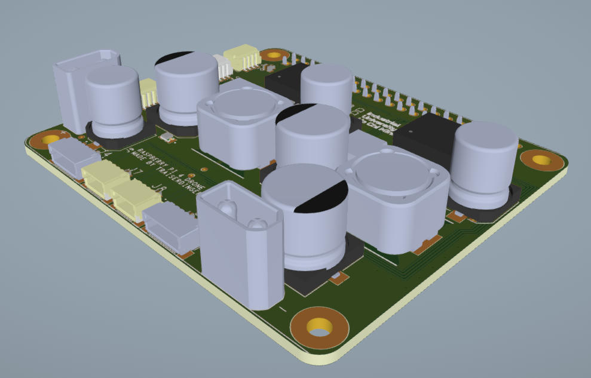 | 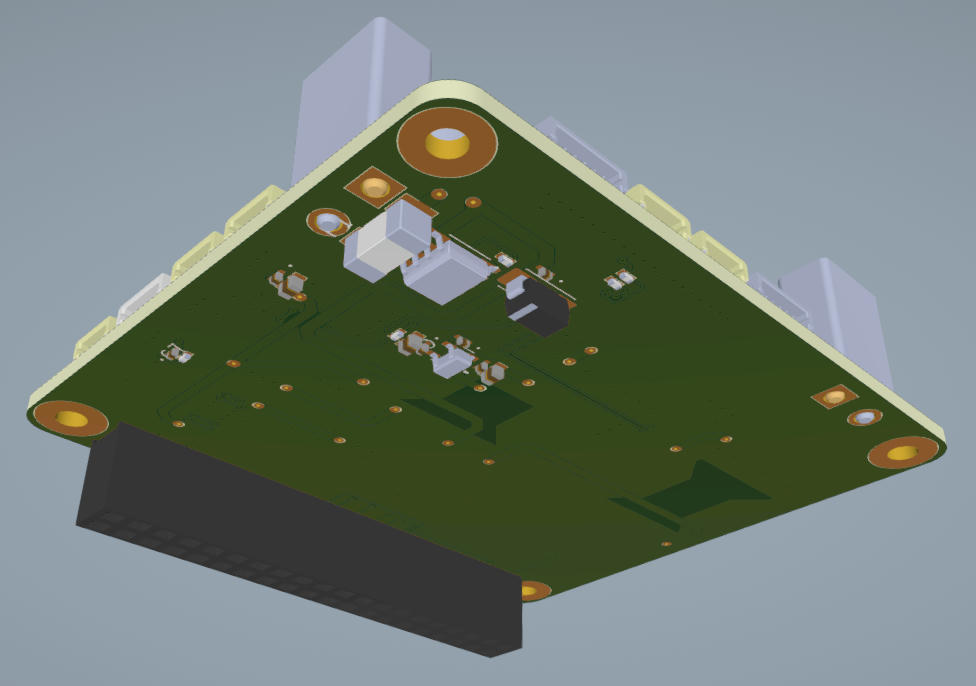 |
| **Top** | **Bottom** |
| 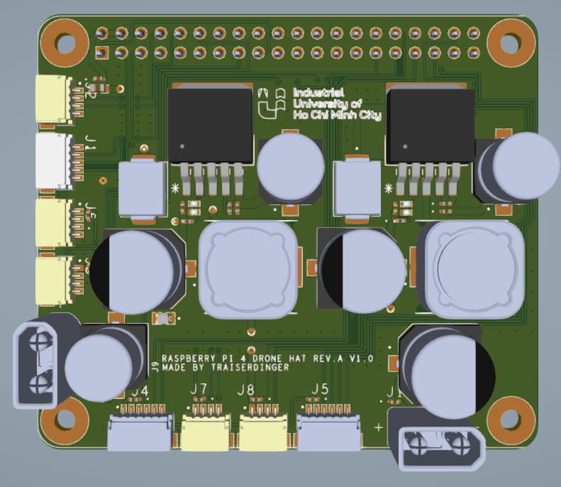 | 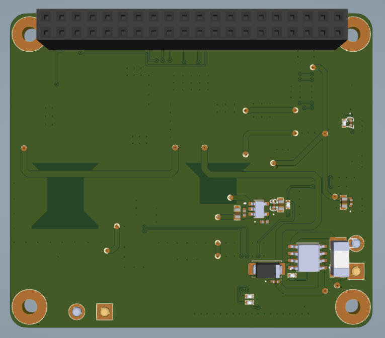 |

## Layers

Rendered from the review artwork of 2026-11-27 14:26, viewed from the top. Board outline added to every plot for reference. The top silkscreen plot is clipped to the board: the artwork still contains a Raspberry Pi 4 outline that runs past the board edge (open item in the review).

| | |
|---|---|
| **Top copper** | **Bottom copper** |
| 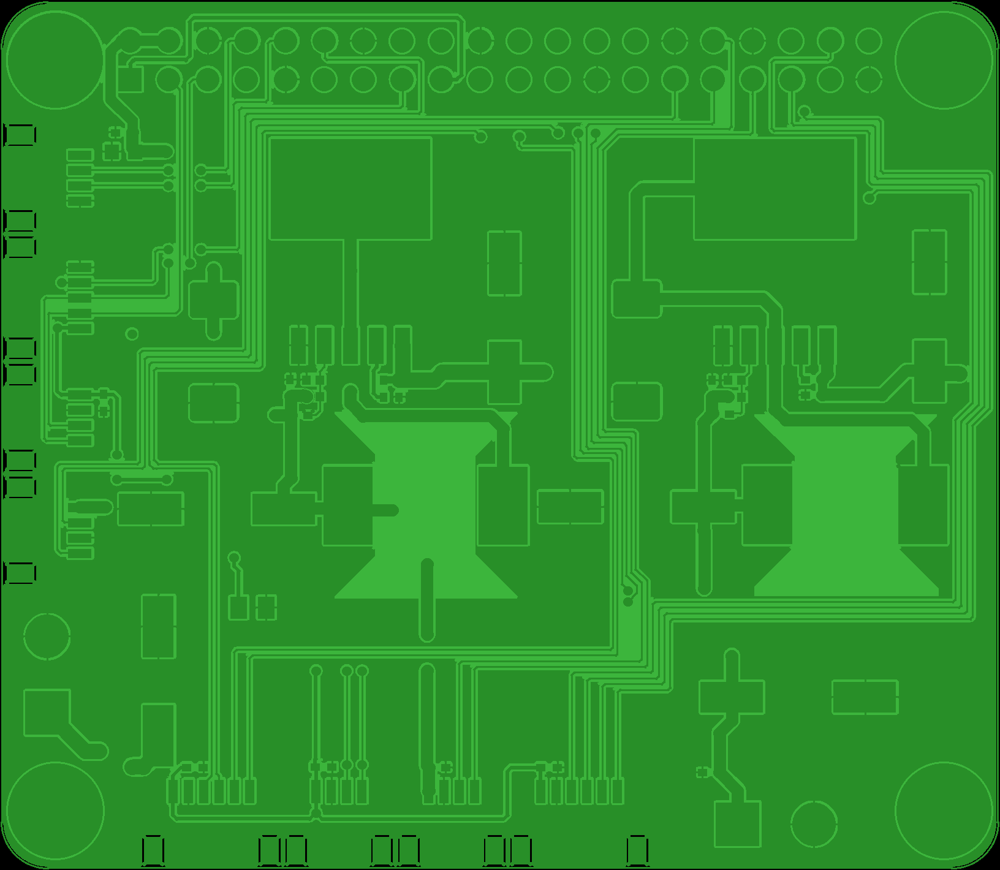 | 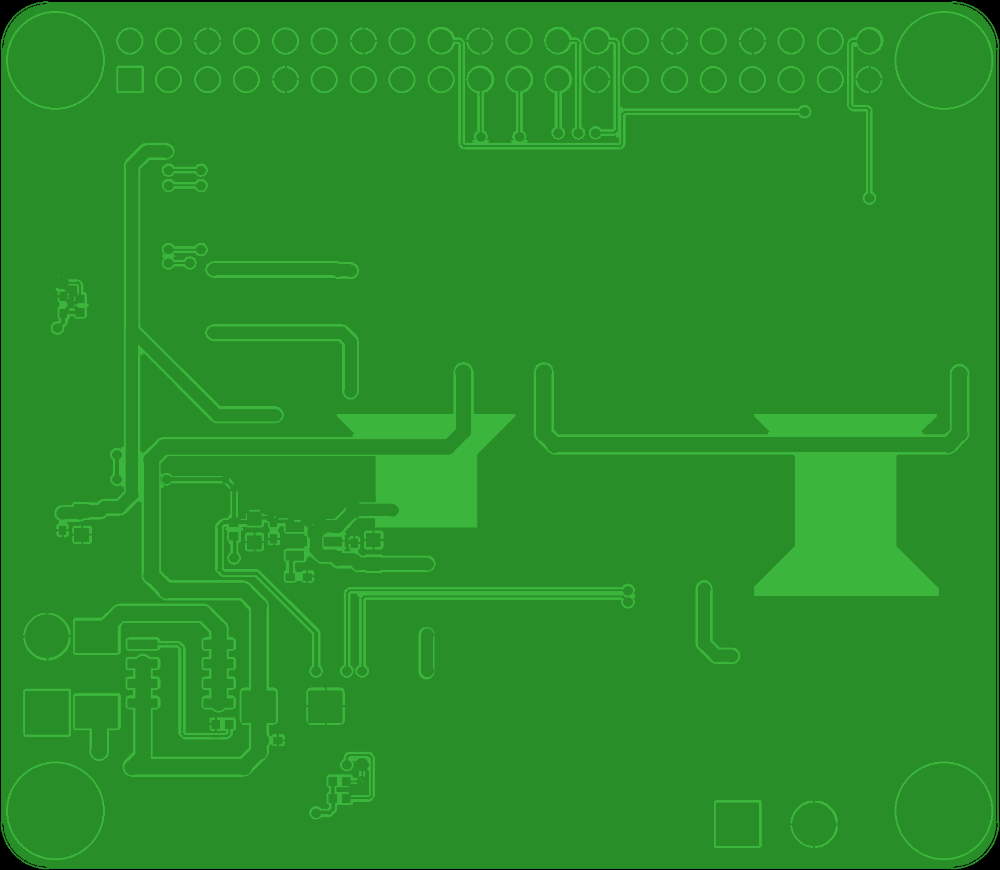 |
| **Silkscreen top** | **Silkscreen bottom** |
| 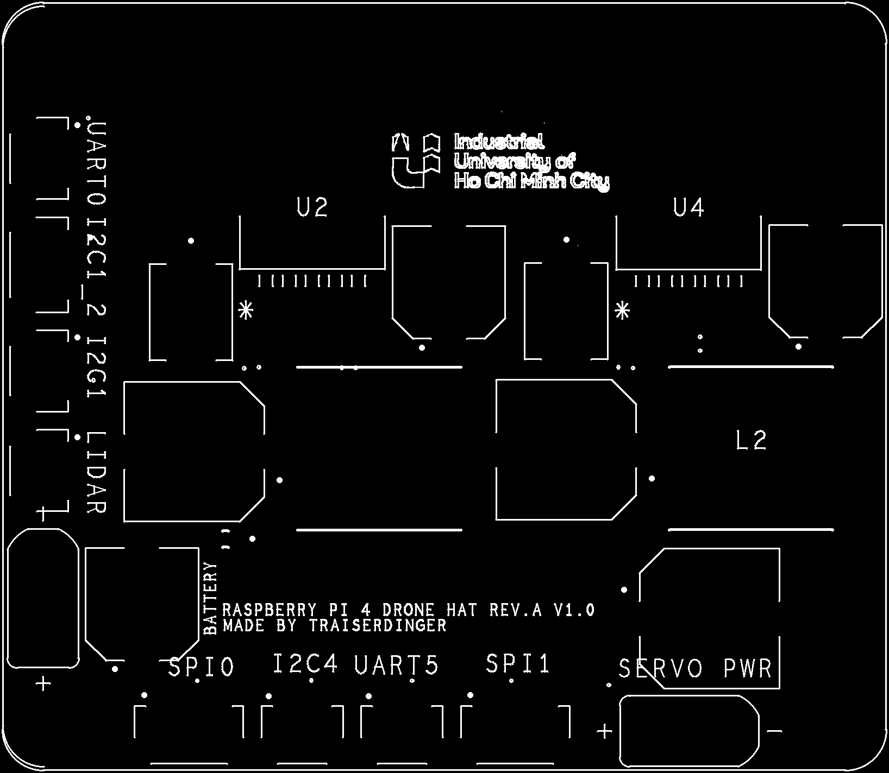 | 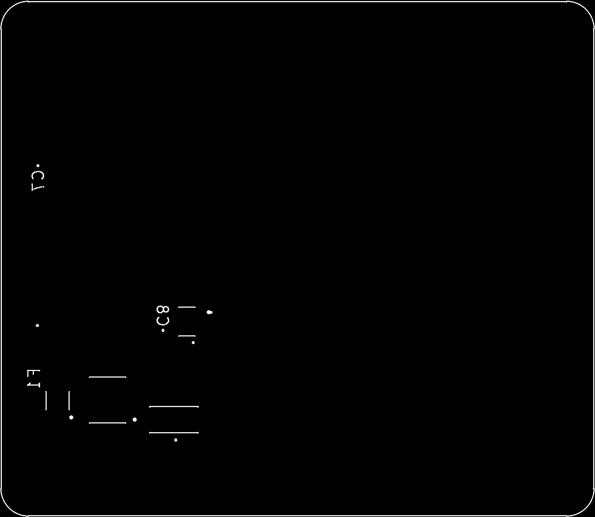 |
| **Solder mask top** | **Solder mask bottom** |
| 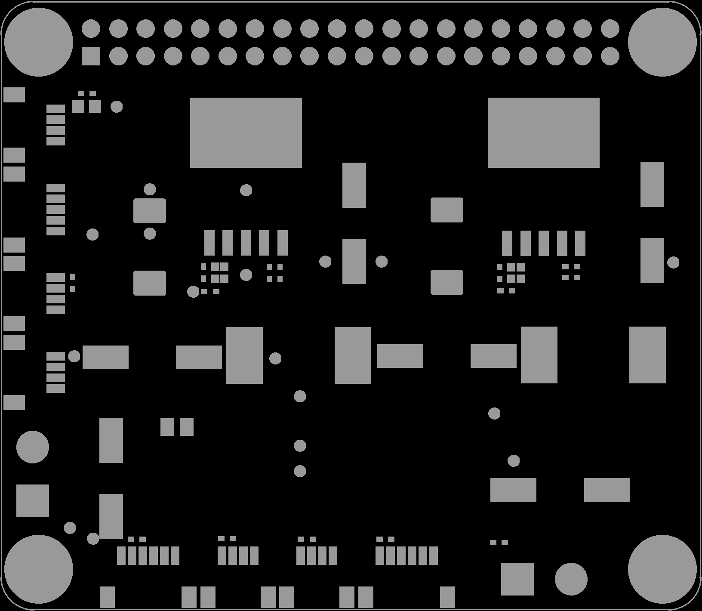 | 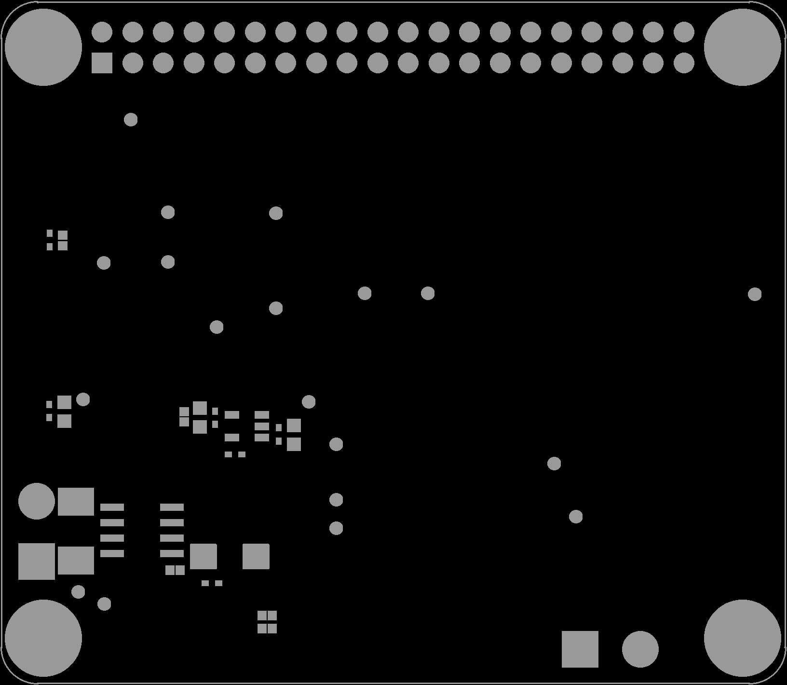 |
| **Paste top** | **Paste bottom** |
| 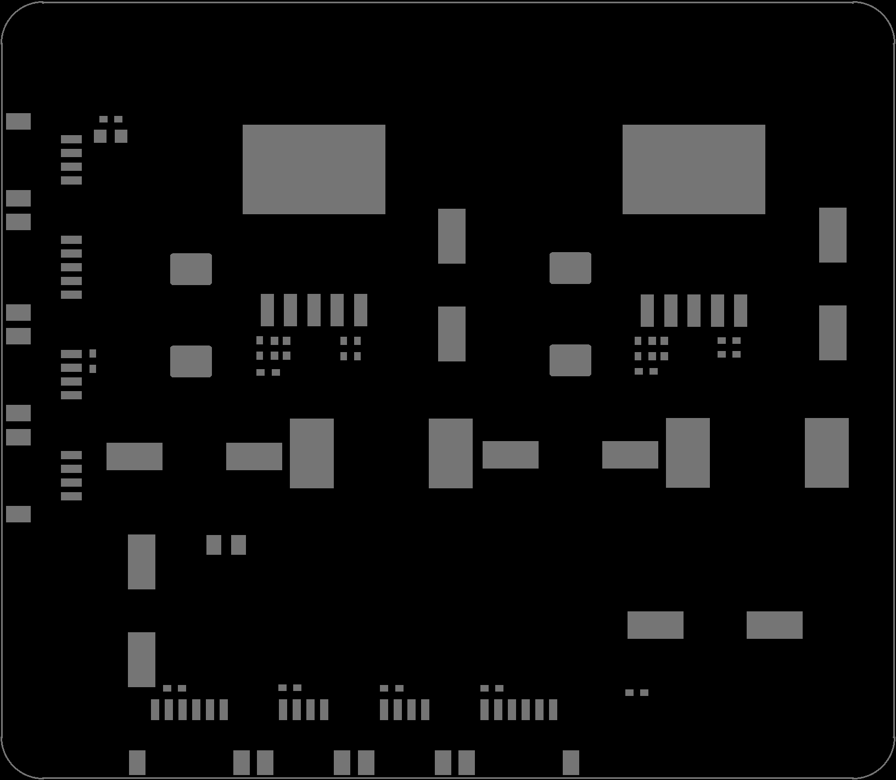 | 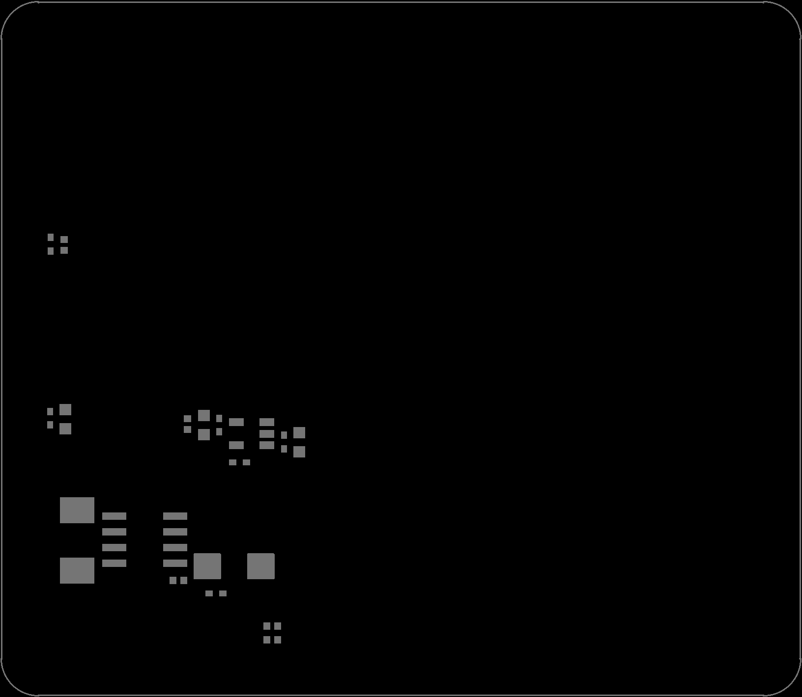 |
| **Board outline** | |
| 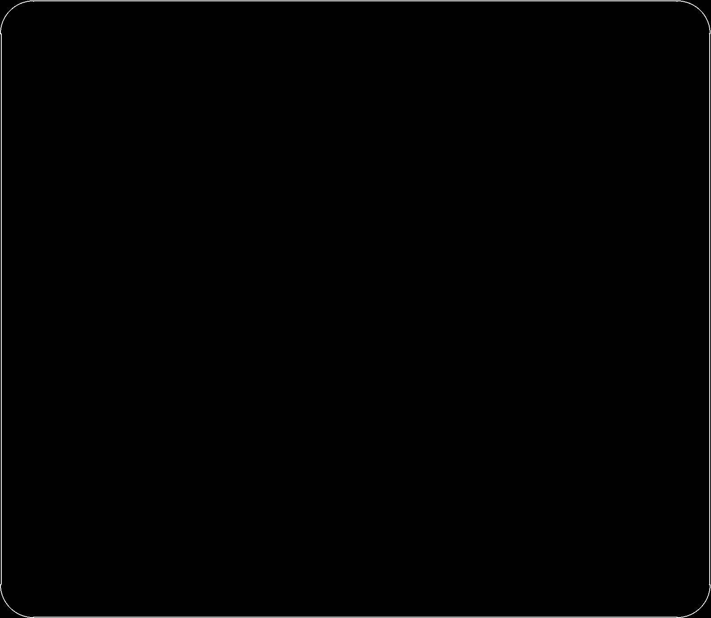 | |
