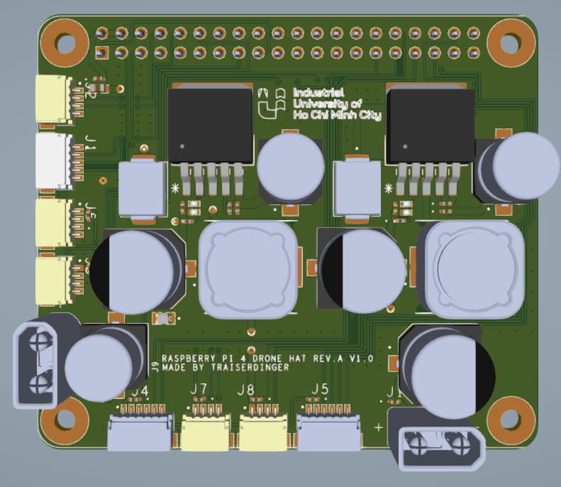
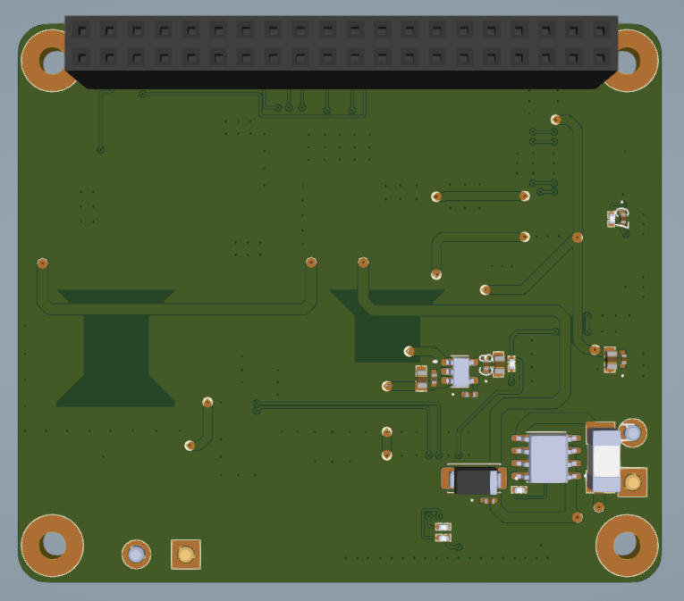

# Raspberry Pi 4 Drone HAT – Rev A (V1.0)

Companion-computer HAT for the Raspberry Pi 4 Model B on the UAV. It powers the Pi straight from the flight battery and breaks out the Pi's UART, I2C and SPI buses to JST-SH connectors for the flight controller, YDLiDAR X2, PCA9685 servo driver and expansion sensors.

Schematic in **OrCAD Capture CIS 24.1** (2 sheets), layout in **Allegro PCB Editor 24.1**.

> **Status:** layout complete, **under design review, not fabricated yet.**
> Open findings are listed in [`docs/rpi4-drone-hat/rev-a-v1.0/REVIEW_RevA.md`](../../../docs/rpi4-drone-hat/rev-a-v1.0/REVIEW_RevA.md) (Vietnamese).
> Gerber and NC drill files are intentionally **not** published for this revision.

| Top | Bottom |
|---|---|
|  |  |

## Board

| Item | Value |
|---|---|
| Size | 65 × 56.5 mm, R3 corners (Raspberry Pi HAT outline) |
| Mounting | 4× Ø2.75 mm plated holes, 58 × 49 mm pitch (M2.5) |
| Layers | 2 (TOP / BOTTOM), GND pour on both sides |
| Vias | 0.30 mm and 0.33 mm drill, through |
| Parts | 62. Most parts on top; the input-protection parts (Q1, F1) and a few small parts on the bottom (see the bottom render). The 2×20 female header U1 is fitted on the bottom side |
| Passives | 0402 (Samsung CL05 / TE 0402); 10 µF in 0603; bulk caps are SMD aluminium electrolytics |

## Hardware

| Block | Parts | Notes |
|---|---|---|
| Battery input | J9 XT30 → F1 → Q1 AO4407A → `+BAT` | Q1 is a P-MOSFET for reverse-polarity protection (gate to GND through R10 10k). D4 SMBJ18A TVS and C26 220 µF on `+BAT`. **3S–4S only (max 16.8 V)** |
| Pi 5 V | U2 XL4015E1 buck, L1 22 µH, D1 B540C | `+BAT` → `+5_MCU` 5.04 V (R1 3.3k / R2 10k). Feeds header pins 2/4, J3 (LiDAR) and J8 |
| 3.3 V | U3 RT9193-33 LDO (300 mA) | `+5_MCU` → `+3.3`. Supplies the connector 3.3 V pins and the I2C4/OE pull-ups. The Pi's own 3V3 pins (1, 17) are not used |
| Servo power | U4 XL4015E1 buck, L2 22 µH, D3 B540C | `+BAT` → `+5_SERVO` 5.04 V on J10 XT30, separate from the Pi rail (common GND) |
| Status | D2 LED + R3 220 Ω | On `+3.3` |
| Servo kill | GPIO22 → PCA9685 `OE` | R9 10k pull-up: servo outputs are off until the Pi drives OE low |

## Connectors

All signal connectors are **JST-SH 1.0 mm** (SM0xB-SRSS-TB). Signals are **3.3 V logic, not 5 V tolerant**.

| Ref | Port | Pin 1 → n | Pi bus |
|---|---|---|---|
| J1 | PCA9685 | GND, OE (GPIO22), SCL, SDA, +3.3 | I2C1 |
| J2 | FC UART | NC, TX (GPIO14), RX (GPIO15), GND | UART0 |
| J3 | YDLiDAR X2 | +5 V, LiDAR TX → GPIO5, GND, M_CTR (GPIO18) | UART3 RX, PWM0 |
| J4 | SPI0 | +3.3, GND, SCK (11), MOSI (10), MISO (9), CE0 (8) | SPI0 |
| J5 | SPI1 | +3.3, GND, SCK (21), MOSI (20), MISO (19), CS (24) | SPI1 |
| J6 | I2C1 | +3.3, GND, SDA (2), SCL (3) | I2C1 |
| J7 | I2C4 | +3.3, GND, SDA (6), SCL (7) | I2C4 |
| J8 | UART5 | +5 V, GND, TX (12), RX (13) | UART5 |
| J9 | Battery in | XT30 (male, PCB) | – |
| J10 | Servo power out | XT30 (male, PCB) → PCA9685 V+ | – |

J2 pin 2 is the Pi's TX: a PX4 TELEM cable needs TX/RX crossed. Device tree settings are in [`software/pi-config/config.txt`](../../../software/pi-config/config.txt).

## Files

| Path | Content | Tool |
|---|---|---|
| `schematic/RASPBERRYPI4DRONEHAT.DSN` | Schematic design (includes design cache) | Capture CIS 24.1 |
| `schematic/RaspberryPi4DroneHat.opj` | Capture project | Capture CIS 24.1 |
| `pcb/RaspberryPi4DroneHat_REV_A.brd` | Board database | Allegro PCB Editor 24.1 |
| `pcb/RaspberryPi4DroneHat.map` | 3D model mapping for 3D Canvas / STEP export | Allegro |
| `netlist/pst*.dat` | Netlist exported from Capture (2026-11-27 15:24); last Import Logic into the board reported 0 changes | text |
| `bom/RPi4_DroneHAT_RevA_BOM.csv` | Grouped BOM with CIS part numbers and MPN. The *Note* column flags wrong or missing MPNs | CSV |
| `bom/RPi4_DroneHAT_RevA_PartList.csv` | One line per part | CSV |
| `reports/` | Allegro reports generated 2026-11-27: DRC, waived DRC (67, all reviewed), unconnected pins, dangling lines/vias, shape islands, trace length by width | text |
| `step/RaspberryPi4DroneHat_REV_A.step.zip` | Assembled board 3D model (STEP AP214, mm) | any MCAD |

Documentation in [`docs/rpi4-drone-hat/rev-a-v1.0/`](../../../docs/rpi4-drone-hat/rev-a-v1.0):

- [`RPi4_DroneHAT_RevA_Schematic.pdf`](../../../docs/rpi4-drone-hat/rev-a-v1.0/RPi4_DroneHAT_RevA_Schematic.pdf): full schematic, 2 sheets.
- [`layers/`](../../../docs/rpi4-drone-hat/rev-a-v1.0/layers): PNG plot of every artwork layer.
- [`3d/`](../../../docs/rpi4-drone-hat/rev-a-v1.0/3d): renders from Allegro 3D Canvas.
- [`REVIEW_RevA.md`](../../../docs/rpi4-drone-hat/rev-a-v1.0/REVIEW_RevA.md): schematic, layout and Gerber review.

## Opening the project

1. Keep `schematic/` and `pcb/` under the same parent folder, or point Capture to the board when using *PCB → Update/Open Board*.
2. Open `RaspberryPi4DroneHat.opj` in Capture CIS 24.1. The design cache inside the `.DSN` contains all symbols, so the original `.OLB` libraries are not needed to view or print.
3. Open `pcb/RaspberryPi4DroneHat_REV_A.brd` in Allegro PCB Editor 24.1. Footprints and padstacks are stored in the board.
4. Part data (MPN) comes from a private CIS database that is not included; the resolved values are exported in `bom/`.
